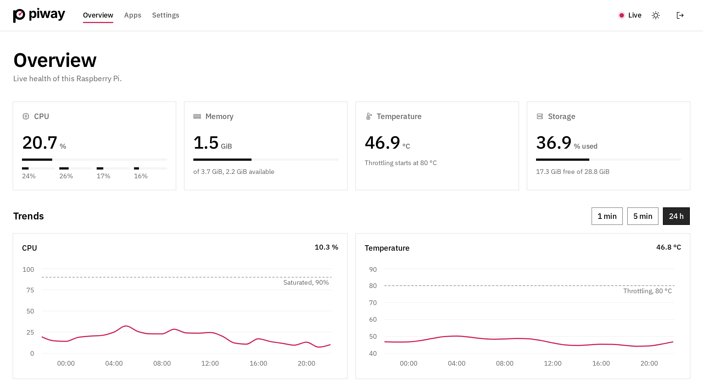
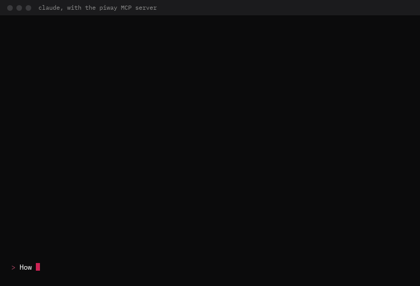

<h1 align="center">
  <picture>
    <source media="(prefers-color-scheme: dark)" srcset="docs/brand/piway-logo-white.svg">
    
  </picture>
</h1>

<p align="center">
  <b>Your Raspberry Pi, run like a small cloud.</b><br>
  A live metrics dashboard, <code>git push</code> deploys to your own subdomains, alerts on your phone,<br>
  and an MCP server so Claude Code can operate it. One Go binary.
</p>

<p align="center">
  <a href="https://github.com/OFK0/piway/actions/workflows/ci.yml"></a>
  <a href="https://github.com/OFK0/piway/releases/latest"></a>
  <a href="LICENSE"></a>
</p>

<p align="center">
  <a href="https://ofk0.github.io/piway/"><b>Documentation</b></a> ·
  <a href="#install">Install</a> ·
  <a href="#deploy-an-app">Deploy an app</a> ·
  <a href="#use-it-from-claude-code">Claude Code</a>
</p>

<picture>
  <source media="(prefers-color-scheme: dark)" srcset="docs/demo/dashboard-dark.png">
  
</picture>

## What you get

| | |
| --- | --- |
| **Live dashboard** | CPU per core, memory, temperature and throttling, disks and network, every second over a WebSocket, with history kept gently on the SD card. [Storage](docs/STORAGE.md) |
| **Deploys** | Push to GitHub, or deploy from the API or Claude: piway builds an arm64 image on the Pi, health-checks it and switches traffic with no downtime. Rollback, restart and static sites included. [Deploying](docs/DEPLOY.md) |
| **Your own subdomains** | Each app at `https://<name>.local:8443` on your network (or on 443 after one setting), through Caddy, with names published over mDNS. [Publishing apps](docs/PROXY.md) |
| **Alerts on your phone** | Rules for heat, throttling, a weak power supply, full disks and failed deploys, sent as Web Push notifications with no third-party account. [Alerts](docs/ALERTS.md) |
| **Claude Code built in** | An MCP server: check status, list apps, deploy, restart, roll back and read logs, with confirmation before anything changes. [MCP](docs/MCP.md) |
| **Safe by default** | A password and API tokens, nothing reachable from other machines until a password is set, remote access over Tailscale only, rootless Docker, and a hardening guide. [Remote access](docs/REMOTE.md) · [Hardening](docs/HARDENING.md) |
| **Prometheus** | `/metrics` for Prometheus or Grafana, next to a JSON API. [API](docs/API.md) |

## Install

On a Raspberry Pi 4 (tested; other 64-bit Pis should work) with 64-bit
Raspberry Pi OS, Desktop or Lite:

```sh
curl -fsSL https://raw.githubusercontent.com/OFK0/piway/main/install.sh | sh
```

The script installs the latest release, after checking its checksum, and
starts `piway setup`. Setup installs only what is missing: the piway
service, rootless Docker, Caddy and mDNS for your apps, the dashboard
password and, if you want, Tailscale. It shows its plan and every `sudo`
command before running it, and is safe to run again.

Then open the dashboard at the address setup prints. The
[install guide](docs/INSTALL.md) has the options (`--dry-run`, `--yes`, …),
uninstalling, and the manual steps.

## Deploy an app

1. Put a `piway.yaml` at the root of the app's repository
   ([MANIFEST.md](docs/MANIFEST.md)):

   ```yaml
   piway: 1
   name: guestbook        # served at https://guestbook.local:8443
   build:
     dockerfile: Dockerfile
   run:
     port: 3000
     health:
       path: /healthz
   ```

   A static site uses `static:` instead, with an optional build command.

2. List the repository in `~/.config/piway/apps.yaml`:

   ```yaml
   deploy:
     - repo: you/guestbook
       branch: main
   ```

3. Deploy: push to `main` with a GitHub webhook set up, or, since GitHub
   usually cannot reach a Pi at home, ask for it:

   ```sh
   curl -X POST -H "Authorization: Bearer $PIWAY_TOKEN" \
     -d '{"repo":"you/guestbook","branch":"main"}' http://localhost:8080/api/v1/deploys
   ```

   or tell Claude *"Deploy the newest commit of guestbook."* Follow the
   build live in the dashboard under **Apps**. [DEPLOY.md](docs/DEPLOY.md)
   covers webhooks, secrets, health checks, rollbacks and limits.

## Use it from Claude Code



*A replay of a real session against a test instance on a Pi 4: the prompts,
tool calls and answers are the recorded ones, shown in order.*

Create an API token in the dashboard (**Settings → API tokens**), then add
piway to Claude Code, over HTTPS through [Tailscale](docs/REMOTE.md):

```sh
claude mcp add -s user --transport http piway https://<pi>.<tailnet>.ts.net/mcp \
  --header "Authorization: Bearer piway_…"
```

or over stdio, with Claude Code on the Pi itself:

```sh
claude mcp add -s user piway -e PIWAY_TOKEN=piway_… -- piway mcp
```

Claude gets six tools: `get_status`, `list_apps` and `tail_logs` read;
`deploy`, `restart_app` and `rollback_app` act only with `confirm: true`,
which Claude sets when you asked for the change. [MCP.md](docs/MCP.md)

## Check an installation

```sh
piway doctor                                # service, Docker, Caddy, disk, clock…
sudo ~/.local/bin/piway doctor --security   # SSH, firewall, fail2ban, updates
```

Each problem comes with the command that fixes it; `piway setup` fixes most
of them. `-json` prints the results for scripts, and the exit status is 1
when a check fails.

## Documentation

Everything is in [`docs/`](docs), and on the
[documentation site](https://ofk0.github.io/piway/).

| Get started | Guides | Reference |
| --- | --- | --- |
| [Install](docs/INSTALL.md) | [Docker](docs/DOCKER.md) | [Configuration](docs/CONFIG.md) |
| [Deploy an app](docs/DEPLOY.md) | [Publishing apps](docs/PROXY.md) | [HTTP API and metrics](docs/API.md) |
| [App manifest](docs/MANIFEST.md) | [Remote access](docs/REMOTE.md) | [Storage](docs/STORAGE.md) |
| [Backups](docs/BACKUP.md) | [Hardening the Pi](docs/HARDENING.md) | [Development](docs/DEVELOPMENT.md) |
| | [Alerts and notifications](docs/ALERTS.md) | [Releasing](docs/RELEASING.md) |
| | [Claude Code (MCP)](docs/MCP.md) | [Roadmap](docs/ROADMAP.md) |

## Development

```sh
make build && make test && make web-test   # build the dashboard and binary, run the tests
make install                                # on the Pi: swap in your build and restart
make deploy-pi PI=pi@raspberrypi.local      # from a laptop: cross-compile, copy, restart
```

[DEVELOPMENT.md](docs/DEVELOPMENT.md) has the tools (also on a Pi without
sudo), running a build next to an installed piway, and the dashboard's dev
server. [CONTRIBUTING.md](CONTRIBUTING.md) has the conventions for issues,
branches, commits and pull requests.

## License

piway is released under the [MIT license](LICENSE). The binary also contains
third-party code and fonts under their own licenses; `make build` collects
them into `THIRD_PARTY_NOTICES.txt`, which ships with every release and is
served by the dashboard (footer › Licenses).
